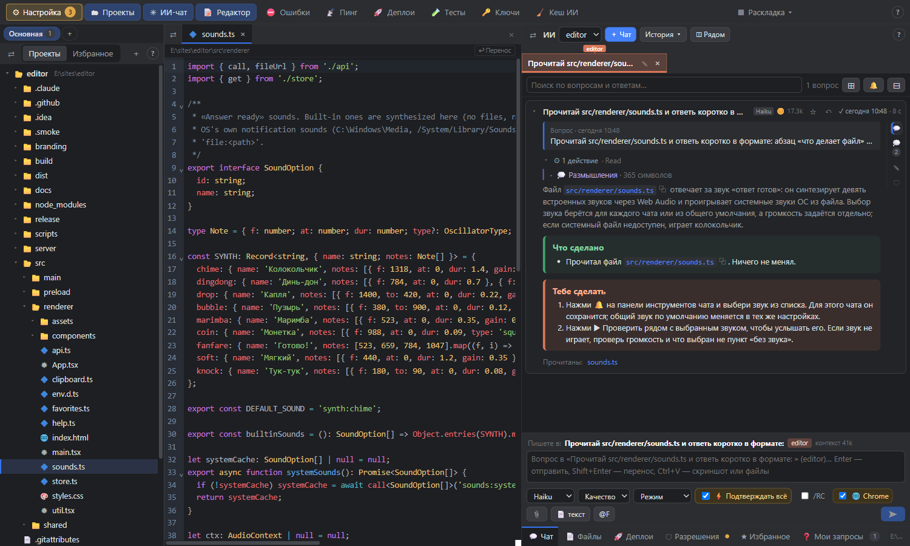
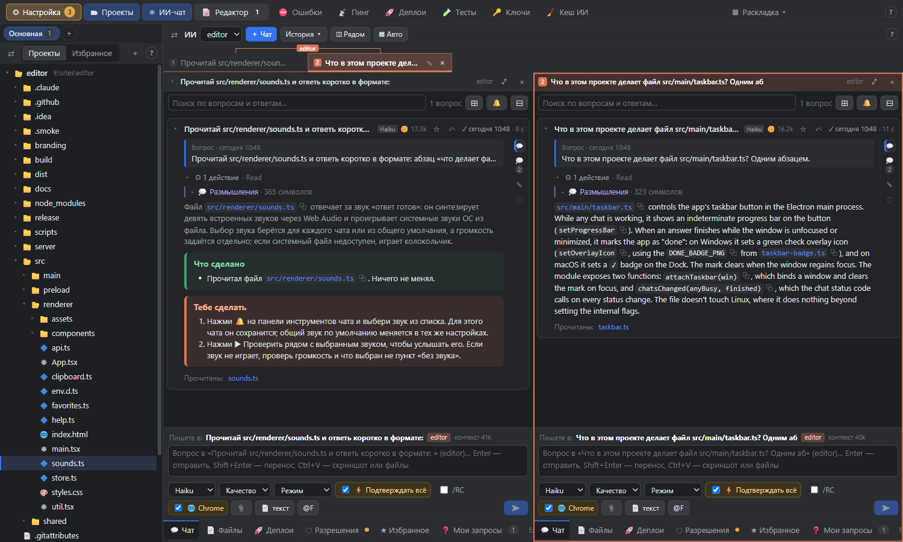

<p align="center"></p>

<h1 align="center">MPI — Meat Proxy Interface</h1>

<p align="center"><i>Редактор кода вокруг чатов с ИИ: ИИ думает, кожаный нажимает кнопки.</i></p>

MPI — десктопный редактор кода, построенный вокруг чатов с ИИ-агентами: Claude Code, Codex, Gemini CLI, OpenCode и Aider.
В нём одновременно идут несколько чатов по каждому проекту, рядом открыты файлы, а панели следят за тем, что происходит дальше: пуши, деплои, тесты,
ключи и ошибки. Название — шутка: ИИ всё придумывает, а человек служит ему «мясным прокси» — запускает команды,
жмёт кнопки, проверяет результат и присылает скриншоты. MPI делает эту работу удобной.

*A desktop code editor built around AI agent chats (Claude Code, Codex, Gemini CLI, OpenCode, Aider): several chats per project, files next to them,
and panels that follow pushes, deploys, tests, keys and problems. The UI is in Russian.*



## Что умеет

**Агенты**
- Claude Code, Codex (OpenAI), Gemini CLI (Google), OpenCode и Aider — модели всех установленных агентов в одном списке.
- DeepSeek и другие модели — через OpenCode (есть бесплатные) или Aider по своему ключу.
- Окно «⚙ Агенты»: что установлено, установка в один клик, вход, ключи.

**Чаты**
- Несколько чатов на проект, у каждого своя история; память проекта (CLAUDE.md, memory) общая.
- Несколько чатов рядом в одном окне (◫ Рядом или Ctrl+клик по вкладке), группы проектов.
- Ответ «гармошкой»: действия, размышления, изменённые файлы, окно «что изменилось в файле».
- Блоки «Тебе сделать / Что сделано / Не сделано» подсвечиваются, команды `! …` запускаются кнопкой ▶.
- Ссылки на файлы открывают файл (даже без пути и в соседнем проекте), ⧉ копирует файл или текст.
- Вкладки «Мои запросы», «Избранное», «Файлы», «Деплои», «Разрешения».
- Удалённый режим /RC — продолжить чат с телефона через claude.ai; Claude in Chrome.
- Перезапуск зависшего ответа (⟳), подсказка следующего вопроса по Tab, история по ↑.
- Сжатие истории с прогрессом, расход токенов с историей по времени, звук «ответ готов».

**Редактор и окно**
- Дерево проектов и избранное, CodeMirror с подсветкой, Ctrl+Tab между файлами, перенос строк.
- Ctrl+колесо — масштаб любого блока; редактор можно скрыть, чтобы чат занял всё место.
- Индикатор работы и «галочка готово» на кнопке в панели задач.

**Панели**
- Деплои: пуш → CI → сайт отдаёт новую версию; smoke-тесты после деплоя, отчёт серверных тестов.
- Ошибки, Ключи (где лежат и когда истекают), Пинг продакшен-адресов, Кеш ИИ на диске.
- Чек-лист «Настройка»: что ещё стоит настроить в проекте.
- Чаты сами управляют панелями через встроенный MCP-сервер `editor`.



## Установка

Готовые сборки — на странице [Releases](https://github.com/oldsadpavel/editor/releases):

- **Windows** — `MPI-<версия>-portable.exe`, установка не нужна.
- **macOS** — `MPI-<версия>-arm64-mac.zip` (Apple Silicon) или `MPI-<версия>-mac.zip` (Intel). Сборка не подписана:
  при первом запуске правый клик → «Открыть», либо `xattr -cr /Applications/MPI.app`.

Основной агент — [Claude Code](https://docs.claude.com/en/docs/claude-code) (`claude`) с выполненным входом;
если его нет, MPI предложит установить. Остальные агенты (Codex, Gemini CLI, OpenCode, Aider) необязательны —
их можно поставить и войти в окне «⚙ Агенты» (пункт в выборе модели).

## Сборка из исходников

```
npm install
npm start          # собрать и запустить
npm run dist       # портативный .exe в release/
```

Electron + React + CodeMirror 6 + [Claude Agent SDK](https://www.npmjs.com/package/@anthropic-ai/claude-agent-sdk).

## Документация

- Подробная инструкция: [docs/ИНСТРУКЦИЯ.md](docs/ИНСТРУКЦИЯ.md); в самом редакторе — кнопки «?» на панелях.
- Облако настроек: настройки можно хранить онлайн — в Insider (вход Microsoft 365) или на своём сервере `server/`
  (Node без зависимостей, вход через любой OIDC, последние 10 версий; см. [server/README.md](server/README.md)).
  В редакторе: меню аккаунта → «☁ Облако настроек».

## Автор и лицензия

Автор — oldsadpavel, [oldsadpavel@gmail.com](mailto:oldsadpavel@gmail.com).

Лицензия [MIT](LICENSE).
